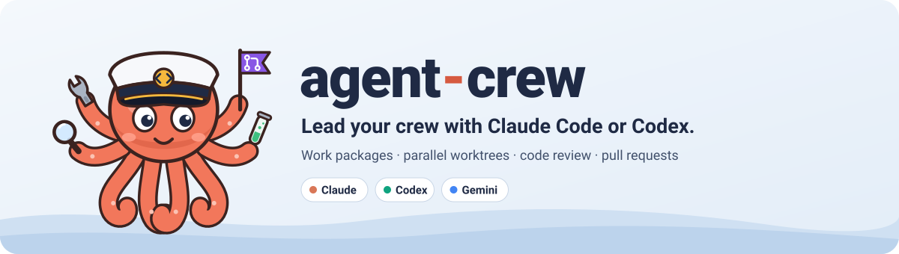
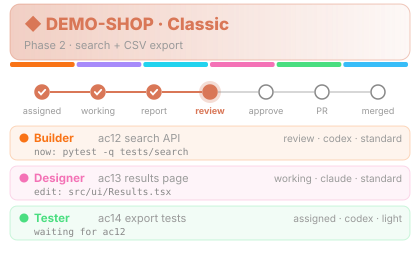
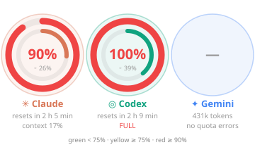
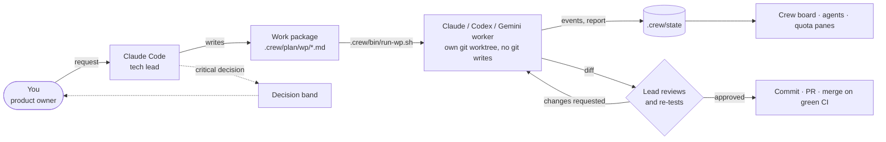
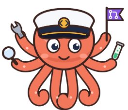

<p align="center">
  <picture>
    <source media="(prefers-color-scheme: dark)" srcset="docs/assets/banner-dark.svg">
    
  </picture>
</p>

<p align="center">
  <a href="https://github.com/badblli/agent-crew/actions/workflows/ci.yml"></a>
  
  <a href="LICENSE"></a>
  <br>
  <b>English</b> · <a href="README.tr.md">Türkçe</a>
</p>

**Make Claude Code the tech lead of a named crew of coding agents, and watch them work.**

Claude Code plans the work, splits it into work packages, hands each one to a Claude Code or Codex worker (optionally Gemini via the Antigravity CLI) in its
own git worktree, reviews the diff, re-runs the tests itself, commits, opens the PR and merges when
CI is green. You stay the product owner: critical decisions come to you in a decision band; everything
else shows up live on a crew board inside Claude Code.

> Status: early, used daily on one real project. Windows + Git Bash tested; macOS/Linux should work
> (bash, git, python, gh) but are not tested yet.

<p align="center">
  
  &nbsp;
  
  <br>
  <sub>Crew board and quota pane, illustrated with demo data.</sub>
</p>

## 60-second quick start

1. Add the marketplace and install the plugin in Claude Code:

   ```text
   /plugin marketplace add badblli/agent-crew
   /plugin install agent-crew@agent-crew
   ```

2. Open a project and say *"set up the crew in this project"*. `crew-init` asks which engines you
   want (Claude workers, Codex workers or both), writes `.crew/` and the instruction files, and
   commits them on a branch with a PR.
3. Start a new session. The crew board, agents and quota panes open on their own.
4. Ask for something real: *"add CSV export to the reports page"*. The lead asks only what it cannot
   infer, writes the work package with acceptance criteria, shows it to you, starts the agents, reviews
   their diffs, and merges when CI is green.

Requirements are listed under [Install](#install).

## How it works



## What you get

- **Three panes**, opened when the session starts:
  - **Crew board** (`/crew`): phase, roadmap progress, every agent with its work package, step, model,
    token use and a live "now" line (the command it runs or the file it edits).
  - **Agents** (`/crew-agents`): one pane to browse every agent with tabs (keys 1–9, `p`/`n`): step
    track, live commands and edits, a colored diff viewer, and the conversation between the lead, the
    agent and you. Send a note to an agent — it goes through the lead first.
  - **Quota** (`/quota`): Claude plan windows and context, Codex 5-hour and weekly limits, Gemini tokens
    today; a toast when an engine passes 90 %.
  On desktop and mobile the panes draw SVG dials, a step track and a team banner; the
  terminal gets colored text bars.
- **Decision band** above the prompt when the lead needs you; pick an option with a key.
- **Model routing**: each work package declares a tier (light / standard / deep / peak); review rounds
  resume the same agent thread on the same model so the cached prompt is reused.
- **Engine choice**: crew-init asks for Claude workers, Codex workers or both and saves `engines`
  in `.crew/config.json`. Set `- Engine: claude|codex|agy` per work package (or `CREW_ENGINE`).
  Without either, the assigned agent's enabled engine is used, then the first configured engine.
  When an engine hits its usage limit the run is marked *paused* with its reset time;
  with `CREW_FAILOVER=claude|agy|codex` the work
  continues on the other engine in the same worktree.
- **Visible Claude workers**: each session is named `<agent> · <wp>`. Agent chat includes
  `open: claude --resume <session_id>`; tell.sh resumes that session for review feedback.
  `CREW_CLAUDE_BG=1` instead launches a session listed by `claude agents`, watched with
  `claude attach "<agent> · <wp>"`. Background mode tracks launch only; the lead records stop
  after checking the session, with no streamed report/chat. Use attach for its feedback.
  `CREW_CLAUDE_PERMISSION_MODE` overrides the worker permission mode (default `auto`), including
  resumed and background sessions. `acceptEdits` alone does not allow headless Bash test commands.
- **Work package lifecycle**: shipped WPs are archived under `wp/done/YYYY-MM/` in the same PR;
  a local `plan.md` shows only active work, `history.md` records merges, and a short handoff card
  lets the next lead session pick up where the last one stopped.
- **Second opinion (optional)**: `jev_route.py` asks TypeSafe's Jev for engine, tier, risk and whether
  the user must decide — one request per work package, only when explicitly enabled. It sends the
  work package title, summary, goal, tasks and acceptance criteria to TypeSafe.
- **Themes**: Classic (default), Creature Tamer (with a battle-dialog decision band), Arcade Maze, Fantasy.
  Agent ids never change, so switching themes is one line.
- **Two skills**: `crew-init` sets a project up; `crew-lead` is the lead's playbook (clarify → write WP →
  run agent → review for real → feedback → ship → merge on green).

## Install

```text
/plugin marketplace add badblli/agent-crew
/plugin install agent-crew@agent-crew
```

Then, in a project: *"set up the crew in this project"* (runs `crew-init`). The board, agents and quota
panes open on the next session start (Turkish projects also get `/ekip`, `/ajanlar`, `/kota`).

Requirements: Claude Code with plugin hooks, git, GitHub CLI (`gh`), Python 3, bash.
Codex workers also need the Codex CLI (logged in). crew-init defaults to both engines when its
Codex check passes, otherwise Claude. Optional: the Antigravity CLI `agy` (signed in; set sandbox permissions in
`~/.gemini/antigravity-cli/settings.json`), `TYPESAFE_API_KEY` for Jev.

## Updating

In a crew project the plugin checks GitHub once a day for a newer version and shows a toast when
one is out: a single read of the published `plugin.json`, nothing sent. Turn it off with the
plugin's *Check for updates* option (`updateCheck`).

`/plugin update agent-crew@agent-crew`, then start a new session. On session start the plugin brings
each crew project's `.crew/bin/` up to the installed version (`tools/sync_bin.py`) and says which
files changed; commit them. A script you edited in the project is left as is and named in a toast.
Nothing is replaced while an agent run is active. Opt out per project with `"autoUpdate": false` in
`.crew/config.json`, or run it by hand: `python <plugin root>/tools/sync_bin.py --project .`.

Changing a script in `templates/bin/`? Run `python tools/sync_bin.py --record` so installed
projects recognise the old version as safe to replace (CI checks this).

Worktrees do not link the main checkout's `node_modules` by default. Linking them with
`CREW_LINK_NODE_MODULES=1` allows an agent to modify that shared directory; use it only if you
accept that access. The lead can run dependency-based checks in the main checkout after review.

## Project layout it creates

```text
.crew/config.json        project, lang (en|tr), engines, planDir, stateDir
.crew/plan/              team.json (roster, steps, phases, themes), models.json, wp/*.md
.crew/plan/wp/done/      shipped WPs, archived by month in the PR that ships them
.crew/plan/plan.md       active work, generated (git-ignored); history.md and history/ likewise
.crew/plan/handoff.md    short card the lead reads at session start
.crew/bin/               board.py, run-wp.sh, tell.sh, lib.sh, sync.sh, usage.py, jev_route.py
.crew/state/             board, conversations, runs (git-ignored)
AGENTS.md                shared hard rules and report format (at most 8 KB)
CLAUDE.md                imports @AGENTS.md on line 1; Claude-only lead note
rule.md                  stack, verified commands, architecture, contracts, proven lessons
feature.md               one feature → entry files → tests table
docs/adr/                decisions, consulted when relevant
.claude/agents/          crew roles for Claude (if selected)
.codex/agents/           crew roles for Codex (if selected)
.crew/roles-rendered.json hashes used to preserve locally edited roles
```

The always-loaded instruction core stays short. Workers read plan/history/handoff, notes and
completed-WP archives only when the assigned WP links them; the lead reads only the handoff card at
session start. Unknown project details stay `unknown`.
Templates ship in English; crew-init translates headings for Turkish projects while preserving
paths, config keys and the shared final-report format.

Regenerate native role definitions from one source with
`python <plugin root>/tools/render_roles.py --project . --engines claude,codex`
(or just `claude` / `codex`). It reads the project's model tiers, reports locally edited files and
leaves them alone. Codex custom agent definitions do not launch themselves or override the
parent sandbox/approval configuration. Repository Codex skills belong in `.agents/skills/`.

Name the lead session once with `/rename <project> lead`. Full WPs use the runner; the lead's
Agent tool is reserved for tiny read-only helpers. Codex runs use `workspace-write`; Claude
workers use `--permission-mode auto` by default and follow the same no-Git-write crew rules.
Worker Claude rate-limit hints are stored in run/state files; chat gets at most one warning per
run when a limit is hit or status is not `allowed`. The quota pane's Claude
account windows come from the lead session. The board's session command is available in agent
chat; dedicated board session/worker-quota widgets require hook support.

The installed crew creates project-specific WPs and local run logs in the destination project.
Review WPs before committing them; keep `.crew/state/` and `.env*` out of Git. Test fixtures in
the plugin should use synthetic events rather than captured agent conversations.

## Meet Reis



Reis (Turkish for *captain*) keeps the crew together: eight arms for parallel agents, each one busy
with a wrench, a magnifier, a test tube or a pull-request flag. The artwork in `docs/assets/` is
generated by `make_brand.py` and `make_previews.py` there; it is MIT-licensed like the rest of the repo.

<br clear="right">

## License

MIT
