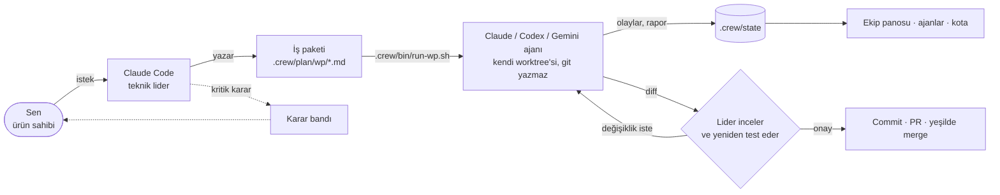

<p align="center">
  <picture>
    <source media="(prefers-color-scheme: dark)" srcset="docs/assets/banner-tr-dark.svg">
    
  </picture>
</p>

<p align="center">
  <a href="https://github.com/badblli/agent-crew/actions/workflows/ci.yml"></a>
  
  <a href="LICENSE"></a>
  <br>
  <a href="README.md">English</a> · <b>Türkçe</b>
</p>

**Claude Code'u, isimli bir kodlama ajanı ekibinin teknik lideri yap ve onları çalışırken izle.**

Claude Code işi planlar, iş paketlerine böler ve her birini kendi git worktree'sinde çalışan bir
Claude Code veya Codex ajanına verir (isteğe bağlı olarak Antigravity CLI üzerinden Gemini). Sonra
diff'i inceler, testleri kendisi yeniden çalıştırır, commit atar, PR açar ve CI yeşil olunca merge eder.
Ürün sahibi sen kalırsın: kritik kararlar karar bandında sana gelir; geri kalan her şey Claude Code
içindeki canlı ekip panosunda görünür.

> Durum: erken aşama, her gün gerçek bir projede kullanılıyor. Windows + Git Bash ile test edildi;
> macOS/Linux'ta çalışması beklenir (bash, git, python, gh) ama henüz test edilmedi.

<p align="center">
  
  &nbsp;
  
  <br>
  <sub>Ekip panosu ve kota paneli, demo veriyle.</sub>
</p>

## 60 saniyede başla

1. Claude Code'da marketplace'i ekle ve eklentiyi kur:

   ```text
   /plugin marketplace add badblli/agent-crew
   /plugin install agent-crew@agent-crew
   ```

2. Bir proje aç ve *"bu projede ekibi kur"* de. `crew-init` hangi motorları istediğini sorar (Claude
   ajanları, Codex ajanları ya da ikisi), `.crew/` ve talimat dosyalarını yazar, bunları bir branch'te
   commit'leyip PR açar.
3. Yeni bir oturum başlat. Ekip panosu, ajanlar ve kota panelleri kendiliğinden açılır.
4. Gerçek bir iş iste: *"rapor sayfasına CSV dışa aktarma ekle"*. Lider yalnızca çıkaramadığı şeyleri
   sorar, kabul kriterleriyle iş paketini yazar, sana gösterir, ajanları başlatır, diff'leri inceler
   ve CI yeşil olunca merge eder.

Gereksinimler [Kurulum](#kurulum) bölümünde.

## Nasıl çalışır



## Neler var

- **Üç panel**, oturum başında açılır:
  - **Ekip panosu** (`/crew`, Türkçe projelerde `/ekip`): faz, yol haritası ilerlemesi, her ajanın iş
    paketi, adımı, modeli, token kullanımı ve canlı "şimdi" satırı (çalıştırdığı komut ya da düzenlediği dosya).
  - **Ajanlar** (`/crew-agents`, `/ajanlar`): sekmelerle tüm ajanlara göz atılan tek panel (1–9, `p`/`n`
    tuşları): adım çizgisi, canlı komutlar ve düzenlemeler, renkli diff görüntüleyici ve lider, ajan ve
    sen arasındaki konuşma. Bir ajana not gönder; not önce lidere gider.
  - **Kota** (`/quota`, `/kota`): Claude plan pencereleri ve bağlam, Codex 5 saatlik ve haftalık
    limitler, bugünkü Gemini token'ları; bir motor %90'ı geçince bildirim.
  Masaüstü ve mobilde paneller SVG kadranlar, adım çizgisi ve takım bandı çizer; terminalde renkli
  metin çubukları görünür.
- **Karar bandı**: lider sana ihtiyaç duyduğunda prompt'un üstünde çıkar; seçeneği bir tuşla seç.
- **Model yönlendirme**: her iş paketi bir seviye belirtir (light / standard / deep / peak); inceleme
  turları aynı ajan thread'ini aynı modelle sürdürür, önbellekteki prompt yeniden kullanılır.
- **Motor seçimi**: crew-init Claude ajanları, Codex ajanları ya da ikisini sorar ve `engines` olarak
  `.crew/config.json`'a yazar. İş paketi başına `- Engine: claude|codex|agy` (veya `CREW_ENGINE`).
  İkisi de yoksa atanan ajanın etkin motoru, o da yoksa ilk yapılandırılmış motor kullanılır.
  Bir motor kullanım limitine takılınca koşu sıfırlanma zamanıyla *paused* olarak işaretlenir;
  `CREW_FAILOVER=claude|agy|codex` ile iş aynı worktree'de diğer motorda devam eder.
- **Görünür Claude ajanları**: her oturumun adı `<ajan> · <wp>`. Ajan sohbetinde
  `open: claude --resume <session_id>` bulunur; tell.sh inceleme geri bildirimi için o oturumu sürdürür.
  `CREW_CLAUDE_BG=1` bunun yerine `claude agents` listesinde görünen bir oturum başlatır;
  `claude attach "<ajan> · <wp>"` ile izlenir. Arka plan modu yalnızca başlatmayı izler; lider oturumu
  kontrol ettikten sonra durdu olarak kaydeder, akan rapor/sohbet olmaz. Geri bildirim için attach kullan.
  `CREW_CLAUDE_PERMISSION_MODE` ajan izin modunu değiştirir (varsayılan `auto`), sürdürülen ve arka
  plan oturumları dahil. `acceptEdits` tek başına başsız (headless) Bash test komutlarına izin vermez.
- **İş paketi yaşam döngüsü**: teslim edilen WP'ler aynı PR içinde `wp/done/YYYY-MM/` altına arşivlenir;
  yerel `plan.md` yalnızca aktif işi gösterir, `history.md` merge'leri kaydeder ve kısa bir devir kartı
  sonraki lider oturumunun kaldığı yerden devam etmesini sağlar.
- **İkinci görüş (isteğe bağlı)**: `jev_route.py` TypeSafe'in Jev'ine motor, seviye, risk ve kullanıcının
  karar vermesi gerekip gerekmediğini sorar. Yalnızca açıkça etkinleştirildiğinde, iş paketi başına tek
  istek. İş paketinin başlığını, özetini, hedefini, görevlerini ve kabul kriterlerini TypeSafe'e gönderir.
- **Temalar**: Classic (varsayılan), Creature Tamer (savaş diyaloğu biçiminde karar bandı), Arcade Maze,
  Fantasy. Ajan id'leri hiç değişmez; tema değiştirmek tek satır.
- **İki skill**: `crew-init` projeyi kurar; `crew-lead` liderin oyun kitabıdır (netleştir → WP yaz →
  ajanı çalıştır → gerçekten incele → geri bildirim → teslim → yeşilde merge).

## Kurulum

```text
/plugin marketplace add badblli/agent-crew
/plugin install agent-crew@agent-crew
```

Ardından bir projede: *"bu projede ekibi kur"* (`crew-init` çalışır). Pano, ajanlar ve kota panelleri
bir sonraki oturum başında açılır (Türkçe projelerde ayrıca `/ekip`, `/ajanlar`, `/kota`).

Gereksinimler: plugin hook desteği olan Claude Code, git, GitHub CLI (`gh`), Python 3, bash.
Codex ajanları için ayrıca Codex CLI (giriş yapılmış). crew-init, Codex kontrolü geçerse varsayılan
olarak iki motoru, geçmezse Claude'u seçer. İsteğe bağlı: Antigravity CLI `agy` (giriş yapılmış; sandbox
izinlerini `~/.gemini/antigravity-cli/settings.json` içinde ayarla), Jev için `TYPESAFE_API_KEY`.

## Güncelleme

Bir ekip projesinde eklenti günde bir kez GitHub'da yeni sürüm olup olmadığına bakar ve varsa bildirim
gösterir: yayımlanmış `plugin.json` tek seferlik okunur, hiçbir şey gönderilmez. Eklentinin
*Check for updates* seçeneğiyle (`updateCheck`) kapatılabilir.

`/plugin update agent-crew@agent-crew`, ardından yeni bir oturum başlat. Oturum başında eklenti her ekip
projesinin `.crew/bin/` klasörünü kurulu sürüme getirir (`tools/sync_bin.py`) ve hangi dosyaların
değiştiğini söyler; bunları commit'le. Projede elle düzenlediğin bir script olduğu gibi bırakılır ve
bildirimde adı geçer. Bir ajan koşusu sürerken hiçbir şey değiştirilmez. Proje bazında kapatmak için
`.crew/config.json` içinde `"autoUpdate": false`, elle çalıştırmak için
`python <eklenti kökü>/tools/sync_bin.py --project .`.

`templates/bin/` içindeki bir script'i mi değiştiriyorsun? `python tools/sync_bin.py --record` çalıştır;
böylece kurulu projeler eski sürümü güvenle değiştirilebilir olarak tanır (CI bunu kontrol eder).

Worktree'ler varsayılan olarak ana checkout'un `node_modules` klasörünü bağlamaz.
`CREW_LINK_NODE_MODULES=1` ile bağlamak, bir ajanın bu paylaşılan klasörü değiştirmesine izin verir;
yalnızca bu erişimi kabul ediyorsan kullan. Lider, incelemeden sonra bağımlılığa dayalı kontrolleri ana
checkout'ta çalıştırabilir.

## Oluşturduğu proje düzeni

```text
.crew/config.json        proje, lang (en|tr), engines, planDir, stateDir
.crew/plan/              team.json (kadro, adımlar, fazlar, temalar), models.json, wp/*.md
.crew/plan/wp/done/      teslim edilen WP'ler, teslim eden PR'da aya göre arşivlenir
.crew/plan/plan.md       aktif iş, üretilir (git-ignore); history.md ve history/ da öyle
.crew/plan/handoff.md    liderin oturum başında okuduğu kısa devir kartı
.crew/bin/               board.py, run-wp.sh, tell.sh, lib.sh, sync.sh, usage.py, jev_route.py
.crew/state/             pano, konuşmalar, koşular (git-ignore)
AGENTS.md                ortak sert kurallar ve rapor biçimi (en fazla 8 KB)
CLAUDE.md                1. satırda @AGENTS.md'yi içe aktarır; yalnızca Claude için lider notu
rule.md                  stack, doğrulanmış komutlar, mimari, sözleşmeler, kanıtlanmış dersler
feature.md               bir özellik → giriş dosyaları → testler tablosu
docs/adr/                kararlar, gerektiğinde bakılır
.claude/agents/          Claude için ekip rolleri (seçildiyse)
.codex/agents/           Codex için ekip rolleri (seçildiyse)
.crew/roles-rendered.json yerelde düzenlenmiş rolleri korumak için hash'ler
```

Her zaman yüklenen talimat çekirdeği kısa kalır. Ajanlar plan/history/handoff, notları ve tamamlanmış
WP arşivlerini yalnızca atanan WP bunlara bağlantı verirse okur; lider oturum başında yalnızca devir
kartını okur. Bilinmeyen proje ayrıntıları `unknown` olarak kalır.
Şablonlar İngilizce gelir; crew-init Türkçe projelerde başlıkları çevirir, yolları, config anahtarlarını
ve ortak final rapor biçimini korur.

Yerel rol tanımlarını tek kaynaktan yeniden üretmek için
`python <eklenti kökü>/tools/render_roles.py --project . --engines claude,codex`
(ya da yalnızca `claude` / `codex`). Projenin model seviyelerini okur, yerelde düzenlenmiş dosyaları
bildirir ve onlara dokunmaz. Codex özel ajan tanımları kendilerini başlatmaz ve üst sandbox/onay
yapılandırmasını geçersiz kılmaz. Depo düzeyindeki Codex skill'leri `.agents/skills/` altına konur.

Lider oturumuna bir kez `/rename <proje> lead` ile ad ver. Tam WP'ler runner'ı kullanır; liderin Agent
aracı yalnızca küçük, salt okunur yardımcılar içindir. Codex koşuları `workspace-write` kullanır; Claude
ajanları varsayılan olarak `--permission-mode auto` kullanır ve aynı "git yazma yok" ekip kurallarına uyar.
Ajan Claude rate-limit ipuçları koşu/durum dosyalarında saklanır; bir limit aşıldığında ya da durum
`allowed` olmadığında sohbete koşu başına en fazla bir uyarı düşer. Kota panelindeki Claude hesap
pencereleri lider oturumundan gelir. Panonun oturum komutu ajan sohbetinde bulunur; ayrı pano oturumu ve
ajan kotası widget'ları hook desteği gerektirir.

Kurulan ekip, hedef projede projeye özel WP'ler ve yerel koşu kayıtları oluşturur. WP'leri commit'lemeden
önce gözden geçir; `.crew/state/` ve `.env*` dosyalarını Git dışında tut. Eklentideki test fixture'ları,
kaydedilmiş ajan konuşmaları yerine sentetik olaylar kullanmalıdır.

## Reis ile tanış


Reis ekibi bir arada tutar: paralel ajanlar için sekiz kol, her biri iş başında: anahtar, büyüteç, test
tüpü ya da pull request bayrağı. `docs/assets/` içindeki görseller oradaki `make_brand.py` ve
`make_previews.py` ile üretilir; reponun geri kalanı gibi MIT lisanslıdır.

<br clear="right">

## Lisans

MIT
